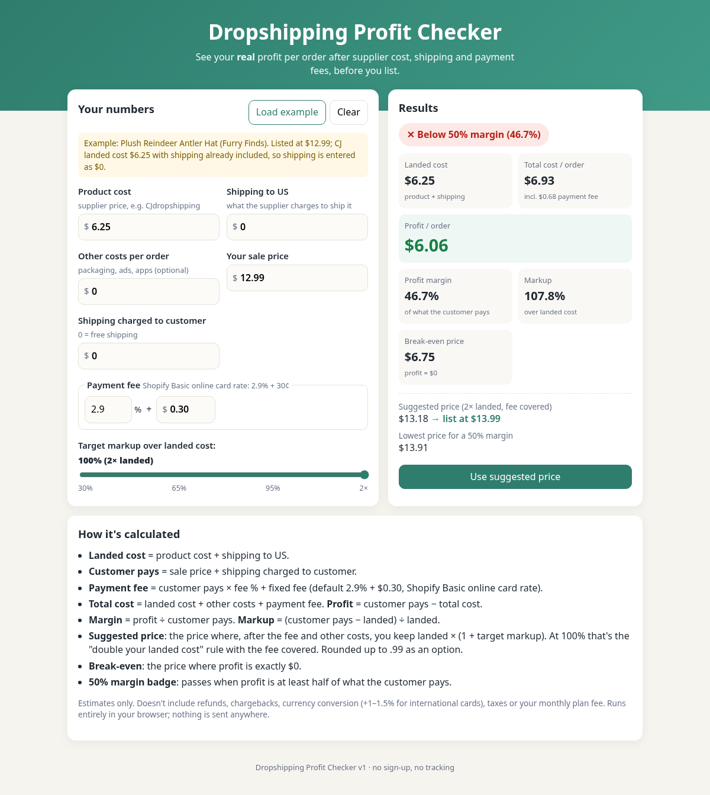

# Dropshipping Profit Checker (v1)

A single-page, static profit calculator for dropshippers. Plain HTML/CSS/JS: no backend, no accounts, no tracking, no external requests. Open `index.html` in any browser.

## Files
- `index.html`, `style.css`, `app.js`: the page and UI wiring
- `calc.js`: pure calculation functions (browser + Node)
- `calc.test.js`: automated tests (`node --test calc.test.js`)
- `screenshot.png`: desktop screenshot of the page

## Inputs
Product cost (supplier/CJ price), shipping to US, other costs per order (default $0), payment fee % and fixed fee (default 2.9% + $0.30), sale price, shipping charged to customer (default $0 = free shipping), target markup slider (30–95% in 5% steps, plus 100% = 2× landed).

## Formulas
- Landed cost `L = product + shipping`
- Customer pays `R = sale price + shipping charged`
- Payment fee `fee = R × f + F` (f = fee %, F = fixed fee)
- Total cost `= L + other + fee`; Profit `= R − total cost`
- Margin `= profit ÷ R`; Markup `= (R − L) ÷ L`
- Price that nets N after the fee: `P = (N + F) / (1 − f) − shipping charged`
  - Suggested price: N = `L × (1 + markup) + other` (markup 100% = the "2× landed cost" rule, with the fee covered); also shown rounded up to the next .99
  - Break-even: N = `L + other`
  - Lowest price for 50% margin: `P = (L + other + F) / (1 − f − 0.5) − shipping charged`
- Badge: "Clears 50% margin" when margin ≥ 50% (Furry Finds rule); red if below or losing money.

Not included: refunds/chargebacks, international-card surcharge (+1%), currency conversion, sales tax, the monthly plan fee.

## Fee source
Shopify pricing page (https://www.shopify.com/pricing), checked Oct 26 2026: Basic plan "Online standard card rates 2.9% + 30¢" (premium cards 3.5% + 30¢, international +1%, third-party payment provider fee 2%). Both fee fields are editable.

## Example preset
"Load example" uses a real Furry Finds listing, read from the store via the Shopify Admin API on Oct 26 2026: **Plush Reindeer Antler Hat**, price $12.99, cost $6.25. That cost is the CJ *landed* cost (shipping included), so shipping is entered as $0.
Result: fee $0.68, profit $6.06, margin 46.7% (below 50% after fees, though 51.9% before fees), markup 107.8%, break-even $6.75, 2× suggested $13.18 → $13.99.

## Tests
`node --test calc.test.js`: 9 tests covering the preset, shipping charged and custom fees, suggested price at every slider step, break-even and 50%-margin prices, impossible margins, charm rounding, bad input, defaults, and loss detection.

## Hosting (not done)
It's a static site, so any free static host works, e.g. a Render Static Site (publish directory = this folder, no build command), GitHub Pages, Cloudflare Pages or Netlify.

## Live
Hosted free as a Render static site: https://profit-checker.onrender.com (no build step; publish directory is the repo root).

